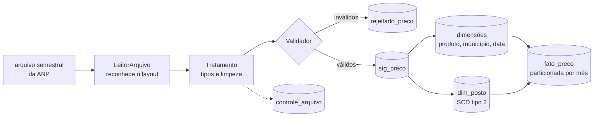
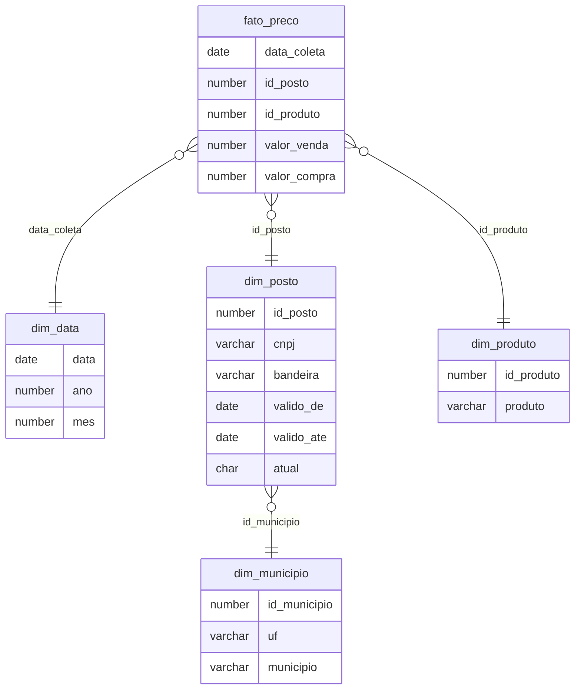

# preços de combustíveis da anp no oracle

Pipeline que carrega a série histórica de preços de combustíveis da ANP num **modelo dimensional no Oracle**, com carga incremental, histórico de mudanças dos postos (SCD tipo 2) e controle de qualidade.

Os arquivos públicos da ANP são grandes, mudam de layout ao longo dos anos e trazem postos que trocam de bandeira e de endereço. É um bom exemplo de dado do mundo real para mostrar como um pipeline lida com isso.

## fluxo



## modelo dimensional



## decisões

**histórico do posto com SCD tipo 2**
Quando um posto troca de bandeira, de nome ou de endereço, a versão antiga é fechada e uma nova é aberta. Assim, um preço de janeiro continua ligado à bandeira que o posto tinha em janeiro.

| cnpj | bandeira | valido_de | valido_ate | atual |
|---|---|---|---|---|
| 11111111000111 | IPIRANGA | 2024-01-02 | 2024-03-14 | N |
| 11111111000111 | BRANCA | 2024-03-15 | | S |

**carga idempotente**
Dimensões e fato são carregadas com `MERGE`. Rodar o mesmo arquivo duas vezes não duplica nada, e cada arquivo tem o hash registrado em `controle_arquivo`: se ele não mudou, o pipeline pula.

**tudo ou nada**
Staging, dimensões e fato ficam na mesma transação. Se qualquer etapa falhar, nada é gravado, e o erro fica registrado no controle.

**dado ruim não derruba a carga**
Registros com CNPJ inválido, data impossível ou preço fora da faixa vão para `rejeitado_preco`, com o motivo e o conteúdo original. O resto do arquivo segue normalmente.

**layouts diferentes**
O `LeitorArquivo` padroniza os nomes das colunas (sem acento, minúsculo) e usa um mapa para chegar sempre no mesmo formato. Se faltar uma coluna obrigatória, o arquivo é recusado com a lista do que falta, em vez de carregar errado.

**fato particionada por mês**
`fato_preco` usa particionamento por intervalo mensal. Consultas filtradas por período leem só as partições necessárias.

## como rodar

Suba o Oracle:

```bash
docker compose up -d
```

O primeiro start leva alguns minutos. Quando `docker ps` mostrar o container como `healthy`, instale as dependências:

```bash
python -m venv .venv
source .venv/bin/activate        # no windows: .venv\Scripts\activate
pip install -r requirements.txt
```

Carregue a amostra que vem no repositório:

```bash
python main.py --arquivo dados/exemplo/ca-amostra.csv
```

Ou baixe e carregue um semestre real da ANP:

```bash
python main.py --ano 2024 --semestre 1
```

As tabelas são criadas automaticamente na primeira execução. Para carregar de novo um arquivo que já foi processado, use `--reprocessar`.

## consultas prontas

- `sql/analises/preco_medio_mensal.sql`: preço médio por estado e produto, com variação mês a mês, média móvel de 3 meses e ranking dos estados mais caros
- `sql/analises/historico_bandeira.sql`: postos que mudaram ao longo do tempo, com cada versão

## testes

```bash
pytest
```

Os testes rodam sem Oracle. Eles cobrem a leitura de layouts diferentes, o tratamento dos valores, a separação dos registros inválidos, a remoção de duplicados e o comportamento do pipeline: pular arquivo já processado, reprocessar e desfazer tudo quando a carga falha.

## limitações conhecidas

- os arquivos devem ser carregados em ordem cronológica, para o histórico dos postos ficar correto
- o endereço dos arquivos da ANP pode mudar; ele fica na variável `anp_url_base`

## repositórios relacionados

- [esteira-anp](../esteira-anp): roda este pipeline no Airflow 3, com dev, hml e prod no Kubernetes e deploy por pull request
- [qualidade-anp](../qualidade-anp): checagens de qualidade, alertas, fichas dos processos e laboratório de incidentes
